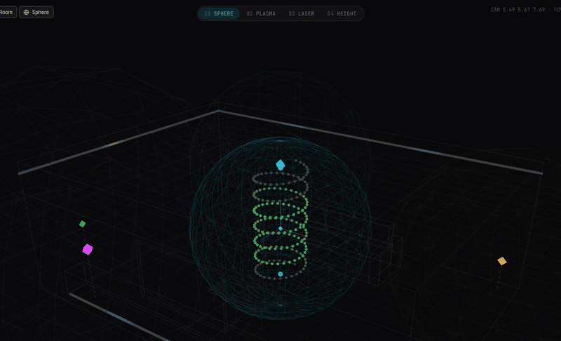
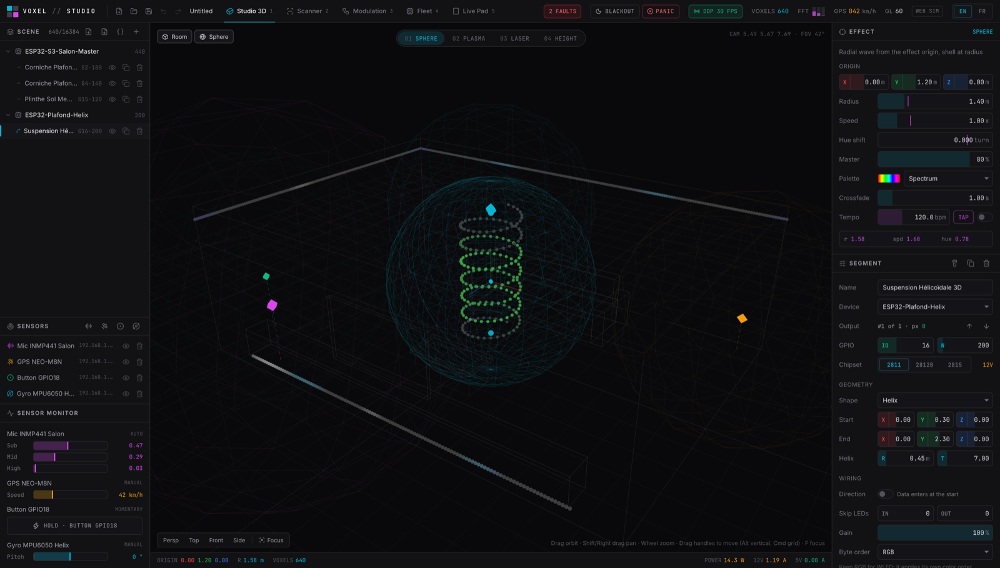
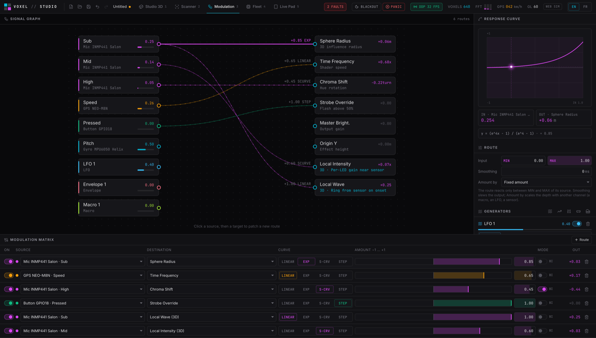
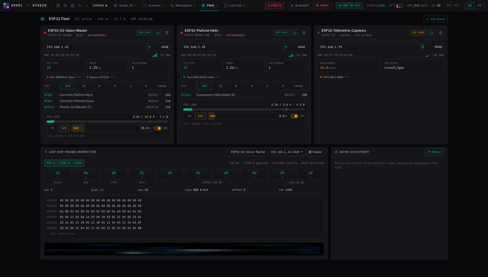
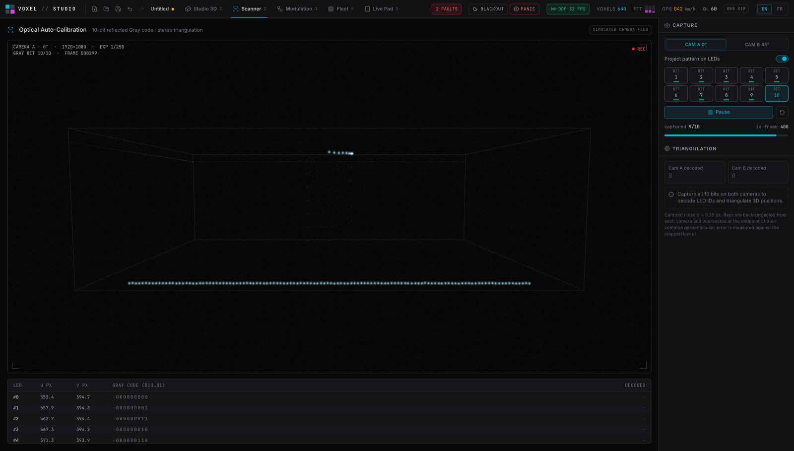
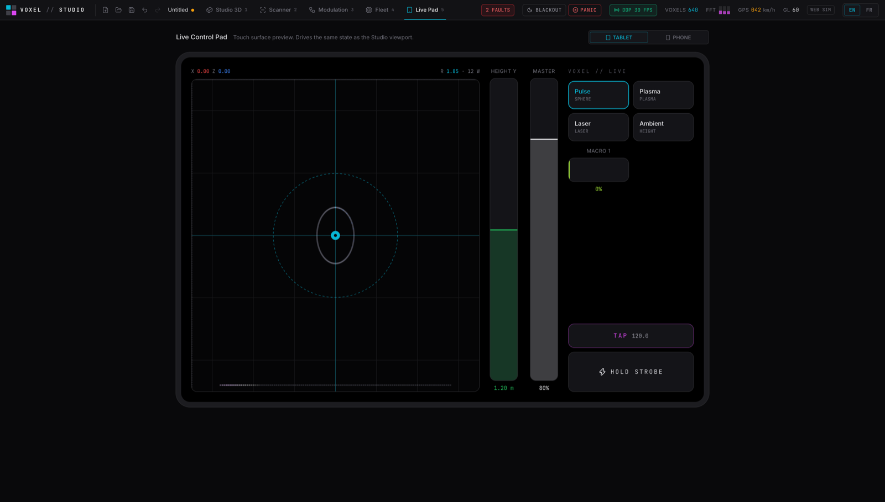
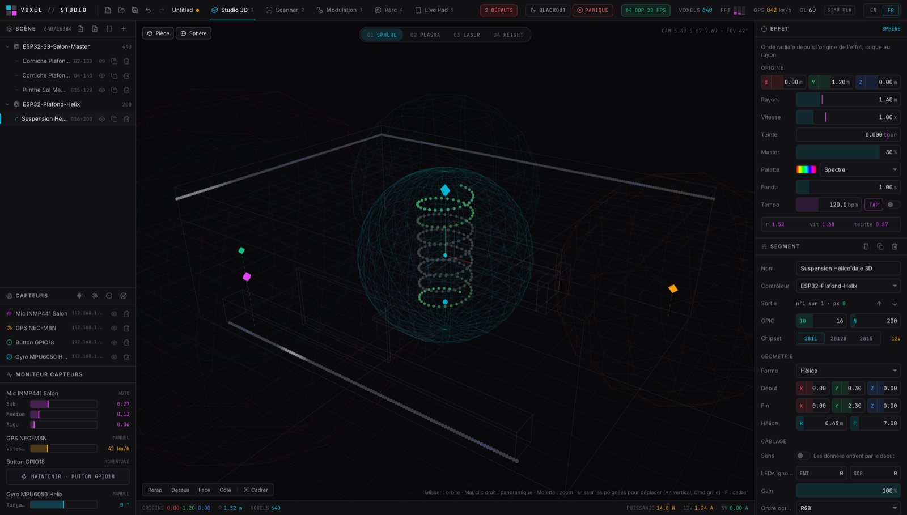
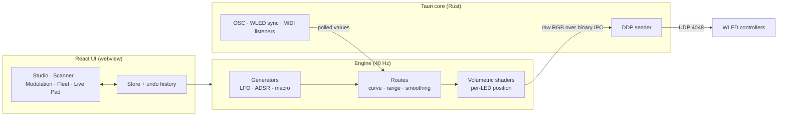

<div align="center">

# VOXEL // STUDIO

**Volumetric pixel mapping and live sensor modulation for addressable LEDs.**

Place LED strips in a 3D room, run volumetric shaders through them, patch sensors, LFOs, MIDI or OSC onto the effect, and stream the result to every WLED controller over UDP DDP at 40 FPS.

[](https://github.com/souProjet/voxel-studio/actions/workflows/ci.yml)
[](LICENSE)




</div>

## Why

LED effects on WLED are designed in one dimension: a strip index from 0 to N. Real installations are not flat. A helix hanging from the ceiling, two coves along the walls and a plinth under the TV share one room, and an effect should travel through that room, not along each strip separately.

VOXEL // STUDIO gives every LED a position in meters, evaluates shaders in 3D space, and sends the frames to the controllers that drive the wires. WLED keeps doing what it does well (driving the pixels, power limiting, Wi-Fi), the studio does the spatial part.

## Tour

### Studio 3D



Build the room from lines, helices, polylines, arcs, serpentine matrices or imported point clouds. Drag handles in the viewport (Alt for vertical, Cmd/Ctrl to snap to the grid), switch camera presets, and undo everything. The inspector covers both the effect (origin, radius, speed, hue, palette, crossfade time, tempo) and the selected segment: controller, GPIO, chipset, LED count, geometry and wiring (data direction, skipped LEDs, gain, byte order).

### Modulation



A patch graph from sources to effect parameters. Each route has a curve (linear, exponential, S-curve, step), an amount, an input range, smoothing, and an optional second source that scales its depth. Spatial targets (`Local Intensity`, `Local Wave`) act around the sensor's position in the room instead of on the whole scene.

Sources:

| Source                  | Details                                                                                  |
| ----------------------- | ---------------------------------------------------------------------------------------- |
| Simulated sensors       | Audio, GPS speed, button and gyro scenarios for designing without hardware               |
| Microphone              | Web Audio FFT folded into sub, mid and high bands                                        |
| WLED audio sync         | Listens to the AudioReactive usermod broadcast on multicast `239.0.0.1:11988`            |
| OSC                     | UDP port 9000, `/voxel/<sensor id>/<channel id>`, or any address with an OSC generator   |
| MIDI                    | Every connected port, hot-plugged, with learn: `cc/<ch>/<n>`, `note/<ch>/<n>`, `pb/<ch>` |
| LFO, envelope and macro | Sine, triangle, saw, square and random LFOs (free or tempo-synced), ADSR, manual faders  |

### Fleet



One card per controller: address, reachability, output rate, send time, packets per frame, test patterns (ID, white, R, G, B, chase), and a PSU load estimate with a WLED-style current limiter. The frame inspector decodes the outgoing DDP header and payload byte by byte.

### Optical scanner



Auto-calibration by structured light: the LEDs flash a 10-bit reflected Gray code, two camera views decode the LED IDs, and stereo triangulation recovers the 3D positions. The current build runs on a simulated camera feed with centroid noise, so the error against the mapped layout is measurable.

### Live pad



A performance surface that drives the same state as the studio: XZ pad for the effect origin, height and master faders, scene buttons, macro faders, tap tempo and a hold strobe. Tablet and phone layouts.

### English and French



The interface follows the system language and switches at runtime from the header.

## Features

- **Up to 16,384 LEDs** per project, shaded on the CPU in about 4 ms per frame with crossfade.
- **Four volumetric shaders**: spherical wave, plasma field, laser plane, height spectrum. Six palettes, timed crossfades, tap tempo and tempo-synced speed.
- **Show safety**: blackout that keeps streaming black, panic, release to let controllers fall back to their own effects, autosave with crash recovery, output that keeps running while the window is hidden.
- **Mapping I/O**: import LED positions from CSV, export the per-LED mapping as CSV or JSON.
- **Project files**: open and save JSON projects with native dialogs, undo/redo across the whole project.
- **LAN only**: output and probes are refused for any address outside private, link-local and loopback ranges.

## Getting started

Requirements: Node.js 22+, and Rust stable for the desktop app.

```bash
git clone https://github.com/souProjet/voxel-studio.git
cd voxel-studio
npm install
```

```bash
npm run tauri dev
```

This starts the desktop app with real UDP output. `npm run dev` runs the same interface in a browser at http://localhost:1420 with simulated UDP, which is enough to design a scene.

```bash
npm run tauri build
```

This produces a release bundle in `src-tauri/target/release/bundle`. The bundle is not signed.

### WLED setup

1. Flash WLED on an ESP32 and configure the LED outputs (GPIO, count, chipset) to match the segments in the studio.
2. Give the controller a fixed IP and enter it on its Fleet card. DDP uses UDP port 4048, which WLED listens on by default.
3. Streaming starts with the app. WLED switches to realtime mode while frames arrive; click the DDP indicator in the header to release the stream and let the controllers return to their own effects.

For audio, either use the computer microphone or run the WLED AudioReactive usermod in send mode on one controller: the studio picks up its sync packets on the LAN.

## Keyboard shortcuts

| Keys                     | Action                                       |
| ------------------------ | -------------------------------------------- |
| `1` to `5`               | Studio, Scanner, Modulation, Fleet, Live Pad |
| `B`                      | Blackout (streaming continues)               |
| `Esc`                    | Panic: blackout, strobe off, scan off        |
| `T`                      | Tap tempo                                    |
| `F`                      | Focus the selection in the viewport          |
| `Cmd/Ctrl+S`, `+O`       | Save, open project                           |
| `Cmd/Ctrl+Z`, `+Shift+Z` | Undo, redo                                   |

## Architecture



The engine reads the store every frame, ticks the generators, smooths the route outputs, shades every LED from its 3D position, and hands each controller's RGB buffer to Rust as a raw IPC body (no JSON). Rust splits it into DDP datagrams of 480 pixels and sets PUSH on the last one so WLED displays the frame atomically.

| Path             | Contents                                                                    |
| ---------------- | --------------------------------------------------------------------------- |
| `src/components` | React views: studio, scanner, modulation, fleet, live pad                   |
| `src/services`   | Engine, geometry, shaders, sensors, generators, project files, Tauri bridge |
| `src/state`      | External store with undo history                                            |
| `src/i18n`       | Translation layer and French dictionaries                                   |
| `src-tauri/src`  | DDP sender, OSC/WLED/MIDI inputs, native file dialogs                       |

## Protocols

- **DDP v1** to WLED on UDP 4048: 10-byte header, RGB 8-bit, 1440-byte payloads, PUSH flag on the last packet of a frame.
- **OSC 1.0** messages and bundles on UDP 9000 (int32, int64, float, double, true and false arguments; an address with no argument acts as a trigger).
- **WLED audio sync v2** packets: smoothed volume, peak flag and the 16 GEQ bands.
- **MIDI** control change, note on/off and pitch bend on any channel.

## Development

```bash
npm run check
```

This runs the type check, ESLint, Prettier and Vitest.

```bash
cd src-tauri && cargo test
```

Rust tests. Add `-- --ignored` to include the CoreMIDI loopback test, which needs macOS.

CI runs both on every push to `main` and on pull requests.

## Status

Working: everything above, on macOS. Not done yet: code signing, notarization and auto-update, and a real camera feed for the optical scanner. Windows and Linux builds are untested.

## License

[MIT](LICENSE)
